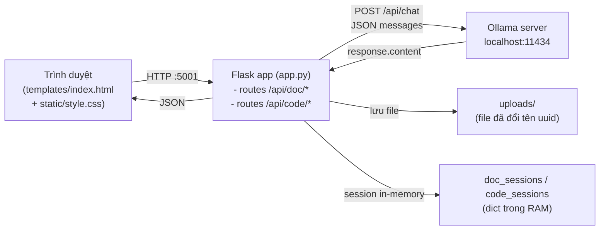
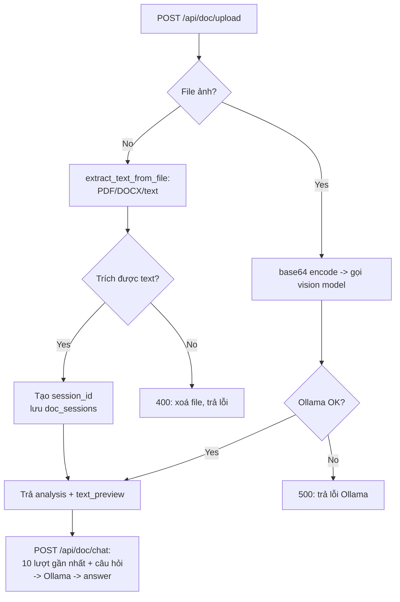

# DocAnalyzer — WebUI phân tích tài liệu & source code bằng AI local

> ⚠️ **LƯU Ý VỀ TÊN THƯ MỤC:** Thư mục này trước đây có tên `tutorial-database`, nhưng **KHÔNG phải** là tutorial về Database. Đây là ứng dụng web **DocAnalyzer** (Flask + Ollama) dùng để phân tích tài liệu và source code bằng AI chạy local. Đã đổi tên thành `tutorial-doc-analyzer` để đúng với nội dung.

## Mục lục

1. [Đây là gì?](#-đây-là-gì)
2. [Kiến trúc tổng quan](#-kiến-trúc-tổng-quan)
3. [Yêu cầu hệ thống](#-yêu-cầu-hệ-thống)
4. [Cài đặt](#️-cài-đặt)
5. [Chạy ứng dụng](#-chạy-ứng-dụng)
6. [Cách sử dụng qua WebUI](#-cách-sử-dụng-qua-webui)
7. [API Endpoints](#-api-endpoints)
8. [Ví dụ curl đầy đủ](#-ví-dụ-curl-đầy-đủ)
9. [Cấu trúc project](#-cấu-trúc-project)
10. [Ghi chú kỹ thuật](#-ghi-chú-kỹ-thuật)
11. [Troubleshooting](#-troubleshooting)
12. [Mở rộng — ý tưởng phát triển tiếp](#-mở-rộng--ý-tưởng-phát-triển-tiếp)
13. [Tài liệu tham khảo](#-tài-liệu-tham-khảo)

---

## 📖 Đây là gì?

**DocAnalyzer** là một WebUI phân tích tài liệu và source code sử dụng **Ollama** (AI chạy hoàn toàn local, không gọi API cloud). Ứng dụng gồm 2 module song song:

| Module | Làm gì | Đầu vào | Đầu ra |
|---|---|---|---|
| **Document** (`/api/doc/*`) | Trích text từ file → AI tóm tắt/phân tích → chat hỏi đáp theo tài liệu | PDF, DOCX, TXT, MD, CSV, JSON, XML, YAML, ảnh (vision) | Session có conversation, hỏi đáp liên tục |
| **Code** (`/api/code/*`) | AI đọc code → nhận diện ngôn ngữ, mục đích, thành phần chính, đề xuất cải thiện | Đoạn code dán trực tiếp (bất kỳ ngôn ngữ nào) | Session có conversation, hỏi đáp liên tục |

Điểm đáng giá nhất: **dữ liệu không rời khỏi máy bạn**. Ollama chạy `localhost`, Flask chạy `localhost` — không có byte nào được gửi ra internet, phù hợp với tài liệu nội bộ, code doanh nghiệp, dữ liệu cần bảo mật.

### Tính năng chính

- 📄 **Upload file đa dạng**: PDF, DOCX, TXT, MD, CSV, JSON, XML, YAML + file ảnh (PNG, JPG, GIF, BMP, TIFF, WebP) qua **vision model**
- 💻 **Phân tích source code**: nhận diện ngôn ngữ, mục đích, thành phần chính (functions/classes), pattern tiềm ẩn, đề xuất cải thiện
- 🤖 **Phân tích tự động**: ngay sau upload, AI phân tích và trả về bản tóm tắt đầu tiên — không cần gõ prompt
- 💬 **Chat với tài liệu/code**: đặt câu hỏi liên tục; AI trả lời **chỉ dựa trên nội dung đã upload** (system prompt khóa context)
- 🧠 **Nhớ hội thoại**: giữ 10 lượt chat gần nhất trong mỗi session làm ngữ cảnh cho câu hỏi tiếp theo
- 🎯 **Câu hỏi gợi ý**: các câu hỏi mẫu nhanh (tóm tắt, điểm chính, kết luận) ngay trên UI
- 🔄 **Đa model**: chọn bất kỳ model Ollama nào đã cài qua `GET /api/models` hoặc dropdown trên UI
- 🖼️ **Vision**: ảnh được mã hoá base64 gửi thẳng cho vision model (VD qwen2.5-vl, llava) — không cần trích text
- 🎨 **Giao diện tối**: dark mode, responsive, drag & drop upload

### Khi nào nên dùng (và không nên)

| Nên dùng | Không nên dùng |
|---|---|
| Tóm tắt hợp đồng, báo cáo, tài liệu kỹ thuật nhạy cảm | Xử lý hàng loạt hàng nghìn file (app chạy 1 file/session) |
| Hỏi đáp về một file code lớn chưa quen | Chat đa tài liệu (mỗi session chỉ gắn 1 file) |
| Phân tích ảnh chụp UI, sơ đồ, bảng biểu (vision model) | Tìm kiếm semantic trên kho tài liệu (không có vector DB) |
| Môi trường offline / không được gửi code ra ngoài | Nhiều người dùng đồng thời (session lưu trong RAM, không có auth) |

---

## 🏗️ Kiến trúc tổng quan

Ứng dụng là một **monolith Flask đơn giản** — không database, không message queue, không dịch vụ ngoài ngoài trừ Ollama local.



### Luồng xử lý một file tài liệu



### Thành phần trong `app.py`

| Thành phần | Vai trò | Giá trị mặc định |
|---|---|---|
| `OLLAMA_URL` | Địa chỉ API Ollama | `http://localhost:11434/api` |
| `DEFAULT_MODEL` | Model dùng khi không chỉ định | `qwen2.5-coder:14b` |
| `MAX_CONTENT_LENGTH` | Giới hạn dung lượng upload | 50 MB |
| `ALLOWED_EXTENSIONS` | Danh sách phần mở rộng cho phép | 18 loại (text + ảnh) |
| `doc_sessions` / `code_sessions` | Session lưu trong RAM | Mất khi restart server |
| `call_ollama()` | Gọi `/api/chat` của Ollama | temperature 0.2, num_predict 4096, timeout 180s |
| `analyze_with_ollama()` | Prompt phân tích (khác nhau cho code/tài liệu) | Cắt nội dung còn 15.000 ký tự |

### Tách lớp prompt

Hai system prompt riêng biệt trong `analyze_with_ollama()`:

- **Document**: "phân tích tài liệu, tóm tắt, nhấn mạnh điểm quan trọng... **trả lời bằng ngôn ngữ của tài liệu**".
- **Code**: "nhận diện ngôn ngữ + mục đích, liệt kê thành phần chính (functions/classes/modules), chỉ ra pattern/vấn đề/đề xuất, mô tả cách hoạt động ở mức cao... **trả lời bằng ngôn ngữ của người dùng**".

Ở chế độ chat, system prompt được dựng lại mỗi lượt với toàn bộ nội dung file (`session['text']`) — đây là cách "RAG giả lập" bằng context window, đơn giản nhưng giới hạn bởi dung lượng context của model.

---

## 📋 Yêu cầu hệ thống

| Thành phần | Phiên bản | Ghi chú | Link |
|---|---|---|---|
| **Python** | 3.8+ | Đã test trên 3.10+ | https://www.python.org/downloads/ |
| **Flask** | **3.1.3** (pin trong requirements.txt) | 3.1.3 là bản fix bảo mật (CVE-2026-27205 ảnh hưởng mọi bản < 3.1.3) — đừng dùng 3.1.1 trở xuống | https://flask.palletsprojects.com/ |
| **Ollama** | **v0.40.x** (10/2026) | Bản mới nhất tại thời điểm viết: v0.40.5 (15/10/2026) | https://ollama.com |
| **Model Ollama** | tuỳ chọn | Mặc định app dùng `qwen2.5-coder:14b`; bản vision cần model hỗ trợ ảnh (VD `qwen2.5vl`, `llava`) | https://ollama.com/library |

> **Vì sao pin đúng version Flask?** Flask 3.1.3 (19/02/2026) vá lỗi session không đánh dấu "đã truy cập" khi chỉ đọc key bằng `in`/`len` — khiến header `Vary: Cookie` bị thiếu và có thể dẫn tới cache poisoning. Bản 3.1.1 trong repo cũ đã lỗi thời về bảo mật.

> **RAM cần bao nhiêu?** Model 14B cần ~10-12 GB RAM/VRAM. Máy yếu hơn: dùng bản 7B (VD `qwen2.5-coder:7b`) — xem phần Troubleshooting.

---

## ⚙️ Cài đặt

### 1. Di chuyển vào thư mục project

```bash
cd tutorial-doc-analyzer
```

### 2. (Khuyến nghị) Tạo virtual environment

```bash
python3 -m venv .venv
source .venv/bin/activate        # macOS / Linux
# .venv\Scripts\activate         # Windows PowerShell
```

### 3. Cài Python dependencies

```bash
pip3 install -r requirements.txt
```

Nội dung `requirements.txt`:

```text
flask==3.1.3
requests==2.32.3
python-magic==0.4.27
PyPDF2==3.0.1
python-docx==1.1.2
```

| Thư viện | Dùng để |
|---|---|
| `flask` | Web server + API routes |
| `requests` | Gọi Ollama API |
| `python-magic` | (utility nhận diện MIME — cần `libmagic` hệ thống) |
| `PyPDF2` | Trích text từ PDF |
| `python-docx` | Trích text từ DOCX/DOC |

> **Lưu ý macOS:** `python-magic` cần `libmagic`: `brew install libmagic` nếu import lỗi.

### 4. Cài Ollama + model

```bash
# macOS: brew install ollama  (hoặc tải app tại ollama.com/download)
# Sau đó đảm bảo server đang chạy:
ollama serve          # hoặc mở app Ollama trong menu bar

# Liệt kê model đã cài
ollama list

# Cài model mặc định của app + 1 model khác để thử
ollama pull qwen2.5-coder:14b
ollama pull deepseek-r1:14b

# Muốn phân tích ảnh? Cài vision model:
ollama pull qwen2.5vl:7b
```

### 5. Kiểm tra Ollama phản hồi

```bash
curl http://localhost:11434/api/tags
# JSON danh sách model = Ollama sẵn sàng
```

---

## 🚀 Chạy ứng dụng

```bash
python3 app.py
```

Output mong đợi:

```text
🚀 Starting AI Local Support
📁 Modules: Document Analysis + Code Analysis
🌐 Open http://127.0.0.1:5001
 * Running on all addresses (0.0.0.0)
 * Running on http://127.0.0.1:5001
```

Mở trình duyệt tại: **http://127.0.0.1:5001**

| Cấu hình chạy | Giá trị | Ghi chú |
|---|---|---|
| Host | `0.0.0.0` | Lắng nghe mọi interface — máy khác trong LAN truy cập được qua IP |
| Port | `5001` | Tránh xung đột AirPlay Receiver (port 5000/5001) trên macOS |
| Debug | `true` | Auto-reload khi sửa code — **tắt khi dùng thật** (`debug=False`) |

---

## 🎮 Cách sử dụng qua WebUI

1. **Mở** http://127.0.0.1:5001
2. **Chọn model** AI từ dropdown (danh sách lấy từ `GET /api/models`; mặc định `qwen2.5-coder:14b`)
3. **Upload file**: kéo-thả hoặc click vào vùng upload (tab tài liệu hoặc tab code)
4. **Xem phân tích**: AI tự động phân tích và hiển thị kết quả ngay sau khi upload xong
5. **Đặt câu hỏi**: nhập câu hỏi về nội dung tài liệu/code — AI trả lời dựa trên nội dung đó
6. **Xoá session**: click icon thùng rác để xoá hội thoại và upload file mới

Mẹo dùng hiệu quả:

- File dài hơn **15.000 ký tự** bị cắt — với tài liệu dài, tách nhỏ trước hoặc hỏi theo phần.
- File **ảnh** cần model hỗ trợ vision; nếu model thường nhận, app sẽ fallback trả lời "Image uploaded. You can ask questions about it."
- Mỗi session là độc lập: muốn phân tích file thứ hai mà không mất hội thoại cũ thì không được — app chỉ giữ 1 session mỗi module cùng lúc trên UI (bấm thùng rác để reset).

---

## 🔌 API Endpoints

Danh sách dưới đây **khớp 1-1 với các route trong `app.py`** (đã đối chiếu 28/10/2026):

| Method | Endpoint | Mô tả | Thân request | Phản hồi chính |
|---|---|---|---|---|
| GET | `/` | Trang chủ WebUI | — | HTML (`templates/index.html`) |
| GET | `/api/models` | Danh sách model Ollama đã cài | — | `{"models": ["qwen2.5-coder:14b", ...]}` |
| POST | `/api/doc/upload` | Upload tài liệu + phân tích tự động | `multipart/form-data`: `file` (bắt buộc), `model` (tuỳ chọn) | `session_id`, `filename`, `file_type`, `analysis`, `text_preview` |
| POST | `/api/doc/chat` | Hỏi đáp về tài liệu đã upload | JSON: `session_id`, `question`, `model` (tuỳ chọn) | `{"answer": "..."}` |
| POST | `/api/doc/session/<session_id>/clear` | Xoá hội thoại của session tài liệu | — | `{"success": true}` |
| POST | `/api/code/analyze` | Phân tích đoạn code | JSON: `code` (bắt buộc), `language` (tuỳ chọn, mặc định `auto-detect`), `model` (tuỳ chọn) | `session_id`, `language`, `analysis`, `code_preview` |
| POST | `/api/code/chat` | Hỏi đáp về code đã phân tích | JSON: `session_id`, `question`, `model` (tuỳ chọn) | `{"answer": "..."}` |
| POST | `/api/code/session/<session_id>/clear` | Xoá hội thoại của session code | — | `{"success": true}` |

### Chi tiết từng endpoint

#### `GET /api/models`

Gọi `GET {OLLAMA_URL}/tags` của Ollama, trả về tên các model. **Fallback:** nếu Ollama không phản hồi, trả `{"models": [DEFAULT_MODEL]}` thay vì lỗi — để UI vẫn hiện dropdown.

#### `POST /api/doc/upload`

Trình tự xử lý trong code:

1. Kiểm tra `file` có trong form và filename khác rỗng → không thì `400`.
2. Kiểm tra phần mở rộng thuộc `ALLOWED_EXTENSIONS` → không thì `400 "File type not supported"`.
3. Lưu file vào `uploads/` với tên `{uuid4-hex}_{filename}` (chống trùng + chống path traversal qua `secure_filename`).
4. **Nếu là ảnh**: đọc file → base64 → gửi prompt vision ("Describe this image in detail...") kèm `image_url` dạng data-URI cho model → session lưu `file_type: "image"` + `base64_image` để các lượt chat sau gửi lại ảnh.
5. **Nếu là text**: `extract_text_from_file()` trích nội dung (PDF qua PyPDF2, DOCX qua python-docx, còn lại đọc UTF-8); trích lỗi/xoá file → `400`.
6. Gọi Ollama phân tích (prompt "document") → trả `analysis` + `text_preview` (500 ký tự đầu).

Mã lỗi có thể gặp: `400` (thiếu file/sai loại/trích text lỗi), `500` (Ollama lỗi).

#### `POST /api/doc/chat`

1. Lấy session theo `session_id` → không có thì `400 "Session not found. Upload a file first."`.
2. Session **ảnh**: gửi lại ảnh base64 + câu hỏi + tối đa **10 lượt hội thoại gần nhất**.
3. Session **tài liệu**: dựng system prompt chứa toàn bộ nội dung file, cộng 10 lượt gần nhất + câu hỏi mới.
4. Trả `{"answer": ...}` và lưu 2 lượt (user + assistant) vào hội thoại của session.

#### `POST /api/code/analyze`

1. `code` bắt buộc, không được rỗng → `400`.
2. Tạo session lưu `code`, `language` (mặc định `auto-detect`), `model`.
3. Gọi Ollama với prompt "code" → trả `analysis` + `code_preview` (500 ký tự đầu) + `session_id`.

#### `POST /api/code/chat`

Tương tự `/api/doc/chat` nhưng system prompt chứa toàn bộ đoạn code + ngôn ngữ. Session không tồn tại → `400 "Session not found. Analyze code first."`.

#### `POST /api/{doc|code}/session/<session_id>/clear`

Xoá hội thoại (giữ nguyên nội dung file/code). Session không tồn tại → `404`.

---

## 🧪 Ví dụ curl đầy đủ

### 1. Xem model khả dụng

```bash
curl http://127.0.0.1:5001/api/models
# {"models":["qwen2.5-coder:14b","deepseek-r1:14b"]}
```

### 2. Upload tài liệu + nhận phân tích tự động

```bash
curl -F "file=@report.pdf" \
     -F "model=qwen2.5-coder:14b" \
     http://127.0.0.1:5001/api/doc/upload
```

Phản hồi mẫu:

```json
{
  "session_id": "3f9c2a7e8b1d4f60a1c2e5d7b9f01234",
  "filename": "report.pdf",
  "file_type": "document",
  "analysis": "Tài liệu này là báo cáo tài chính Q3... (tóm tắt do AI tạo)",
  "text_preview": "BÁO CÁO TÀI CHÍNH QUÝ 3... (500 ký tự đầu)"
}
```

### 3. Chat hỏi đáp về tài liệu (dùng `session_id` vừa nhận)

```bash
curl -X POST -H "Content-Type: application/json" \
  -d '{"session_id": "3f9c2a7e8b1d4f60a1c2e5d7b9f01234", "question": "Tóm tắt tài liệu này"}' \
  http://127.0.0.1:5001/api/doc/chat
# {"answer": "..."}

# Đổi model chỉ cho 1 lượt hỏi:
curl -X POST -H "Content-Type: application/json" \
  -d '{"session_id": "3f9c...", "question": "Rủi ro lớn nhất?", "model": "deepseek-r1:14b"}' \
  http://127.0.0.1:5001/api/doc/chat
```

### 4. Upload ảnh cho vision model

```bash
curl -F "file=@screenshot.png" \
     -F "model=qwen2.5vl:7b" \
     http://127.0.0.1:5001/api/doc/upload
# file_type sẽ là "image"
```

### 5. Phân tích đoạn code

```bash
cat > /tmp/snippet.json <<'EOF'
{"code": "def add(a, b):\n    return a + b", "language": "python"}
EOF

curl -X POST -H "Content-Type: application/json" \
  -d @/tmp/snippet.json \
  http://127.0.0.1:5001/api/code/analyze
# {"session_id": "...", "language": "python", "analysis": "...", "code_preview": "..."}
```

### 6. Chat về code

```bash
curl -X POST -H "Content-Type: application/json" \
  -d '{"session_id": "<id-từ-bước-5>", "question": "Hàm này có edge case nào không?"}' \
  http://127.0.0.1:5001/api/code/chat
```

### 7. Xoá hội thoại session

```bash
curl -X POST http://127.0.0.1:5001/api/doc/session/<session_id>/clear
curl -X POST http://127.0.0.1:5001/api/code/session/<session_id>/clear
# {"success": true}   (session không tồn tại -> 404)
```

---

## 📁 Cấu trúc project

```text
tutorial-doc-analyzer/
├── app.py                  # Backend Flask: 8 routes API + tích hợp Ollama
├── requirements.txt        # Python dependencies (flask 3.1.3)
├── README.md               # Tài liệu này
├── uploads/                # Thư mục lưu file upload (tự tạo khi chạy, tên file có prefix uuid)
├── templates/
│   └── index.html          # Giao diện chính (HTML + JS thuần, gọi /api/*)
└── static/
    └── style.css           # CSS styling (dark theme)
```

Không có file nào khác cần deploy — toàn bộ logic nằm trong `app.py` (~384 dòng), UI là 1 trang HTML.

---

## 📝 Ghi chú kỹ thuật

| Hạng mục | Giá trị / hành vi | Trong code ở đâu |
|---|---|---|
| Upload tối đa | **50 MB** (`MAX_CONTENT_LENGTH`) | `app.config` |
| Cắt nội dung | **15.000 ký tự** đầu + đánh dấu `...[truncated]` | `analyze_with_ollama()` |
| Hội thoại giữ lại | **10 lượt gần nhất** mỗi lần gọi model | các hàm `chat_*` |
| Lưu session | **Trong RAM** (dict) — mất khi restart server | `doc_sessions`, `code_sessions` |
| Port / host | **5001**, host `0.0.0.0`, `debug=True` | cuối `app.py` |
| Ollama API | `http://localhost:11434/api/chat`, timeout **180s** | `call_ollama()` |
| Tham số sinh | `temperature: 0.2`, `num_predict: 4096` | `call_ollama()` |
| Ảnh | base64 data-URI, gửi qua `image_url` (chuẩn OpenAI-style messages) | `/api/doc/upload` |
| Tên file đã lưu | `{uuid4-hex}_{tên-gốc}` sau `secure_filename` | `/api/doc/upload` |
| Vision fallback | Model không hỗ trợ ảnh → session vẫn tạo, trả lời "Image uploaded. You can ask questions about it." | `/api/doc/upload` |

> **Giới hạn đã biết (không phải bug):** session trong RAM → restart mất hết; 1 file/session; không có auth ai cũng gọi được API; nội dung > 15k ký tự bị cắt. Muốn khắc phục — xem phần Mở rộng.

---

## 🐛 Troubleshooting

### Port 5001 đã được sử dụng?

```bash
# Kiểm tra process đang dùng port
lsof -i :5001

# Kill process
kill -9 <PID>
```

Trên macOS, **AirPlay Receiver** thường chiếm port 5000/5001. Tắt tại: *System Settings → General → AirDrop & Handoff → AirPlay Receiver*, hoặc đổi port trong `app.py` (`app.run(..., port=5002)`).

### Ollama không kết nối được?

```bash
# Kiểm tra Ollama đang chạy
ollama list

# Khởi động Ollama nếu cần
ollama serve

# Kiểm tra API phản hồi
curl http://localhost:11434/api/tags
```

Lỗi `"Cannot connect to Ollama. Make sure Ollama is running"` → Ollama chưa chạy hoặc chạy ở địa chỉ khác (sửa `OLLAMA_URL` trong `app.py`). Lỗi 404 khi gọi model → model chưa tải: `ollama pull <model>`.

### Model trả lời chậm / timeout

- Dùng model nhỏ hơn (`qwen2.5-coder:7b` thay vì `14b`).
- Kiểm tra RAM khả dụng (`ollama ps` xem model đang chiếm bao nhiêu).
- Timeout mặc định 180 giây — file gần 15.000 ký tự + model lớn có thể chạm ngưỡng.
- Mac Apple Silicon: bản Ollama mới (v0.40.x) dùng Metal/mlx — cập nhật Ollama lên bản mới để tăng tốc.

### Lỗi cài `python-magic` trên macOS

```bash
brew install libmagic
pip3 install python-magic
```

### File upload bị từ chối "File type not supported"

Kiểm tra phần mở rộng thuộc danh sách cho phép: `txt, pdf, docx, doc, md, csv, json, xml, yaml, yml, png, jpg, jpeg, gif, bmp, tiff, webp`. Lưu ý: đuôi **`.doc` cũ** được python-docx mở bằng `docx.Document()` — một số file `.doc` nhị phân rất cũ có thể trích text lỗi (app trả 400 và xoá file).

### Upload thành công nhưng "analysis" trống với ảnh

Model đang chọn không hỗ trợ vision. Chuyển sang model vision (VD `qwen2.5vl:7b`, `llava`) trong dropdown rồi upload lại. App cố tình không báo lỗi mà trả lời giữ chỗ để bạn vẫn chat được.

### Trả lời bị "quên" nội dung đầu tài liệu

Nội dung > 15.000 ký tự bị cắt. Cách xử lý: tách file, hoặc tăng `max_chars` trong `analyze_with_ollama()` nếu model của bạn có context lớn (kiểm tra bằng `ollama show <model>`).

---

## 🚀 Mở rộng — ý tưởng phát triển tiếp

| Hướng | Làm gì | Vì sao đáng làm |
|---|---|---|
| **Lưu session ra đĩa** | Thay dict bằng SQLite/JSON file theo `session_id` | Restart không mất hội thoại |
| **Streaming phản hồi** | Bật `stream: true` trong payload Ollama + SSE từ Flask | Trải nghiệm "AI đang gõ" thay vì chờ 1 khối |
| **Chunking + RAG thật** | Chia tài liệu dài thành chunk + embeddings (VD `nomic-embed-text`) + tìm kiếm vector | Bỏ giới hạn 15.000 ký tự |
| **Đa file / kho tài liệu** | Cho 1 session gắn nhiều file | Chat đối chiếu nhiều tài liệu |
| **Auth đơn giản** | API key header hoặc Flask-Login | Đang mở hoàn toàn cho LAN |
| **Docker hoá** | Dockerfile + compose (app + Ollama) | Triển khai 1 lệnh, sạch máy |
| **Batch mode CLI** | Script gọi `/api/doc/upload` cho cả thư mục | Xử lý hàng loạt báo cáo |
| **Export hội thoại** | Endpoint tải conversation ra Markdown | Lưu kết quả phân tích vào repo/PM tool |

---

## 📚 Tài liệu tham khảo

- [Flask Documentation](https://flask.palletsprojects.com/) — Flask 3.1.x; xem [Changes](https://flask.palletsprojects.com/en/stable/changes/) cho bản 3.1.3 (19/02/2026, fix bảo mật session)
- [Ollama Documentation](https://ollama.com/docs) · [Ollama GitHub Releases](https://github.com/ollama/ollama/releases) — bản mới nhất 10/2026: v0.40.x
- [Ollama API Reference](https://github.com/ollama/ollama/blob/main/docs/api.md) — chi tiết `/api/chat`, `/api/tags` mà app này dùng
- [PyPDF2 Documentation](https://pypdf2.readthedocs.io/)
- [python-docx Documentation](https://python-docx.readthedocs.io/)

---

> **Chốt:** DocAnalyzer là ví dụ gọn nhất để thấy một app AI local hoàn chỉnh chỉ cần ~400 dòng Python: Flask làm "cầu" giữa trình duyệt và Ollama, session in-memory giữ ngữ cảnh, và toàn bộ dữ liệu ở lại trên máy bạn. Cài Ollama + `pip install -r requirements.txt` + `python3 app.py` — xong trong 5 phút.


